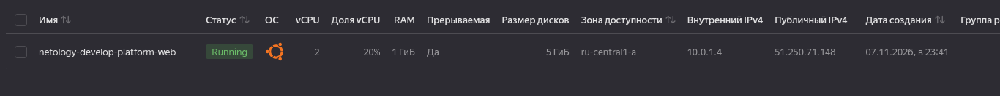
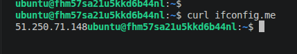
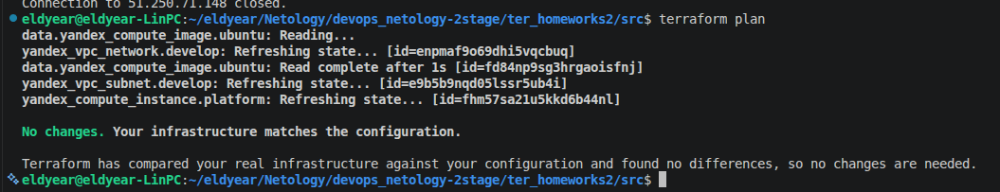
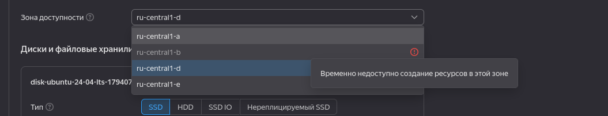
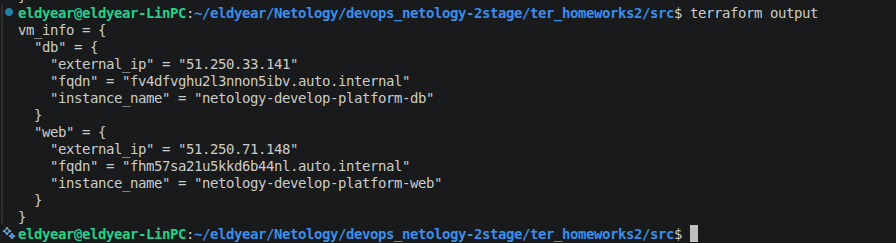
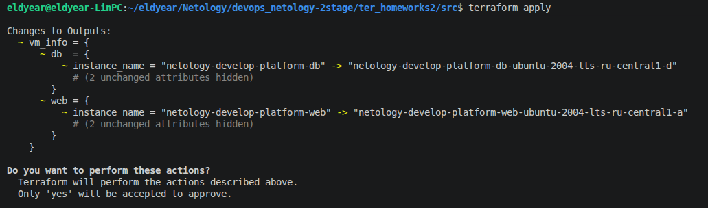

# Домашнее задание к занятию «Основы Terraform. Yandex Cloud» - Элдияр Акматов

## Задание 1

Исправил ошибки поочередно проверив через `terraform validate` `terraform apply`:
- Добавил в [variables.tf](src/variables.tf) cloud_id и folder_id
- `platform_id = "standard-v4a"` было `platform_id = "standart-v4"` t вместо d, после apply выдавал ошибку что standard-v4 не найден.
- Ошибки с знаяениями `core_fraction` `cores`, что для платформы standard-v4a (процессоры AMD) Yandex Cloud разрешает использовать только определенные значения гарантированной доли процессора (core fraction): 20, 50 или 100, было 5. С cores тоже нужно было 2, 4 было 1.

`preemptible = true` (Прерываемые виртуальные машины): Стоят дешевле, но автоматически останавливаются Yandex Cloud через 24 часа (или при нехватке ресурсов в дата-центре). В учебных и тестовых целях это идеальный инструмент для экономии гранта.

`core_fraction = 5` (Гарантированная доля ядра CPU): Позволяет выделить виртуальные ядра с ограничением производительности.Это снижает стоимость ресурсов, а полная мощность процессора 100% времени не требуется. (в моем случае 20%)

скриншрты:

## Задание 2

## Задание 3

Зона `ru-central1-b` не доступен выбрал `ru-central1-d`

## Задание 4

## Задание 5

## Задание 6

Итоговый код проекта в репощитории.